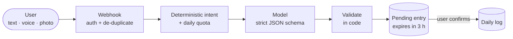

# WhatsApp Nutrition Assistant — Showcase

A WhatsApp assistant that helps people track meals and hydration. Users send a food photo, a voice note or plain text; the model interprets it, estimates the nutrition data, and the user's daily log is stored in Supabase after they confirm.

> **Production code is private because it runs live client systems. This repo documents the architecture and includes selected, sanitized excerpts. Happy to walk through the full codebase on a screen share.**

## Context

- **Problem:** logging food in a calorie-tracking app means searching databases and weighing portions, so people quit. Chatting with an assistant on the app they already use all day lowers that friction.
- **Who it is for:** subscribers of a nutrition-tracking service operated over WhatsApp.
- **My role:** sole developer — architecture, code, integrations, deployment and maintenance.
- **Status, stated plainly:** the system was originally built as an n8n workflow. I am rebuilding it as code (TypeScript on Supabase Edge Functions); the migration is about 80% done. The excerpts in this repo come from the rewrite.

## Demo

[VIDEO LINK] *(pending)*

You can also run a minimal, self-contained version of the core pattern locally — see [Run the demo](#run-the-demo).

## Architecture



1. **Webhook:** validates a shared secret in the database, de-duplicates by message id, answers HTTP 200 right away and replies in the background.
2. **Intent + quota:** code decides whether the text is a confirmation, a cancellation, a correction or a new entry; a new estimate first consumes the daily quota.
3. **Model:** text goes straight to the model; voice notes are transcribed first and photos go to a vision model. Output is a strict JSON schema.
4. **Validate:** caps per entry and a calories-vs-macros cross-check in code.
5. **Pending, then confirmed:** nothing counts until the user confirms. A correction replaces the pending entry.

## Key design decisions

**1. The model estimates; code and the database decide.** The model only classifies (food / water / nothing) and estimates. Output is requested with a strict JSON schema and then validated again in code, because a schema does not make the numbers sensible: hard caps per entry, an empty description is rejected, and calories are cross-checked against the macros (if they disagree by more than 20%, the 4/4/9 formula wins). Which meal it was (breakfast / lunch / dinner) is the user's word, or else decided by the database from the user's local clock. → `excerpts/01`

**2. Nothing counts until the user confirms.** Every estimate is saved as a single *pending* entry that expires after 3 hours; a correction ("it was 3 eggs") makes the model re-estimate with the previous estimate in context and replaces the pending one. The transitions (`save`, `confirm`, `cancel`) are database functions guarded by a per-user advisory lock, so two quick messages cannot create two pending rows or confirm twice. → `excerpts/03`, `excerpts/04`

**3. Deterministic code around one model call.** What to do with a message (confirm, cancel, a bare "no", a correction, a new entry) is decided by code from the text and from whether something is pending. Confirmation is deliberately strict: "yes, but it was 3 eggs" is a correction, not a confirmation. The result is cheap (confirming costs no model call), fast, and testable without a model. → `excerpts/03`

**4. Cost and abuse control before spending tokens.** A daily quota per user is consumed atomically in the database *before* the model is called, and photo scans have their own cap that is returned if the analysis fails. The user's text is embedded in the prompt as a JSON string and the prompt states that the message is data, not instructions. → `excerpts/01`, `excerpts/04`

**5. Model calls never throw.** One function returns `{ ok, data }` or `{ ok: false, detail }` for every failure mode (timeout, HTTP error, refusal, empty content, invalid JSON), so the user always gets an answer. Logs carry the internal user id but never the phone number, the message, or the key. Token usage is recorded best-effort and can never fail the request. A guard catches speech-to-text models inventing subtitle-style phrases on silent voice notes, which would otherwise be shown to the user as if they had said them. → `excerpts/02`

**6. A defensive webhook.** The function is deployed without JWT, so it authenticates its caller with a shared secret validated inside the database. Inbound payloads are normalized defensively (two accepted shapes, username-based ids, implausible timestamps dropped, unreadable messages counted rather than lost). Messages are upserted with `ignoreDuplicates` on the provider message id, so retries never produce double replies. It answers HTTP 200 immediately and works in the background, and a kill switch fails closed: if settings cannot be read, it behaves as OFF. That "shadow mode" let the new system record traffic alongside the old workflow before the cut-over. → `excerpts/05`, `excerpts/06`

All pure logic is isolated from network and database access and receives its dependencies by injection, so it is tested with plain `node --test`, without Deno, a database or a model.

## Stack

- **Language / runtime:** TypeScript on Supabase Edge Functions (Deno) for the production rewrite; Node.js 22 for the demo
- **LLM:** OpenAI — chat completions with strict JSON-schema output, speech-to-text for voice notes, a vision model for photos (direct API calls in production; the official SDK in the demo)
- **Data:** Supabase (Postgres, `pg_cron`, Vault) — replaces the Google Sheets used by the original n8n workflow
- **Messaging:** WhatsApp Cloud API
- **Deployment:** self-managed VPS plus Supabase
- **Original implementation:** n8n

## Repository structure

| Path | What it is |
|---|---|
| `excerpts/` | Real code from the private repo, trimmed and sanitized. Each file starts with what it shows and what was omitted. |
| `excerpts/01-estimation-contract.ts` | Strict schema, prompt structure, validation and calorie cross-check |
| `excerpts/02-model-calls.ts` | Structured-output call with errors as values; silent-audio hallucination guard |
| `excerpts/03-confirmation-flow.ts` | Deterministic intent handling and the estimate → pending → confirm cycle |
| `excerpts/04-pending-and-quota.sql` | Atomic pending-entry state machine and the daily quota, in Postgres |
| `excerpts/05-inbound-normalization.ts` | Defensive parsing of inbound webhook payloads |
| `excerpts/06-webhook-entrypoint.ts` | Authentication, idempotency, background processing, fail-closed kill switch |
| `demo/` | A small, runnable CLI that reproduces the core pattern with a fictional user and no external services |

The excerpts are for reading, not running: they reference each other for illustration and some are not self-contained.

## Run the demo

The demo is a CLI conversation with the assistant for a fictional user. Text only (no WhatsApp, voice or photos), with an in-memory log instead of Supabase. It keeps the same rules as production: strict structured output from the model, validation in code, pending-then-confirm entries, a daily quota, and calorie milestones. Requires Node.js 22+ and an OpenAI API key.

```bash
cd demo
npm install
cp .env.example .env     # then put your key in OPENAI_API_KEY
npm run demo
```

Try, one line at a time:

1. `two scrambled eggs and a slice of toast` → the assistant shows what it detected and keeps it **pending**.
2. `actually it was 3 eggs` → a correction: the pending entry is replaced.
3. `yes` → confirmed. Only now does it count. (Note that confirming makes no model call.)
4. `a glass of water`, then `✅`
5. `report` → today's totals against the daily goals.
6. `/state` shows the raw store; `/reset` starts over.

Things to look at: nothing counts before confirmation; `yes, but it was 3 eggs` is treated as a correction; calories are always consistent with the macros because code enforces it; the meal type comes from the clock, not from the model; a message about the weather is classified as "none" and never saved.

Tests run without an API key (a scripted fake model, plus the real SDK against a local fake server):

```bash
cd demo && npm test
```

Two differences from production: the demo uses strict structured output only, exactly like production's text path, with no tool calling, because the model has nothing to *do*, only to classify and estimate; and the day boundary uses UTC, while production uses each user's own time zone.

## License

All rights reserved. See [LICENSE](LICENSE).
